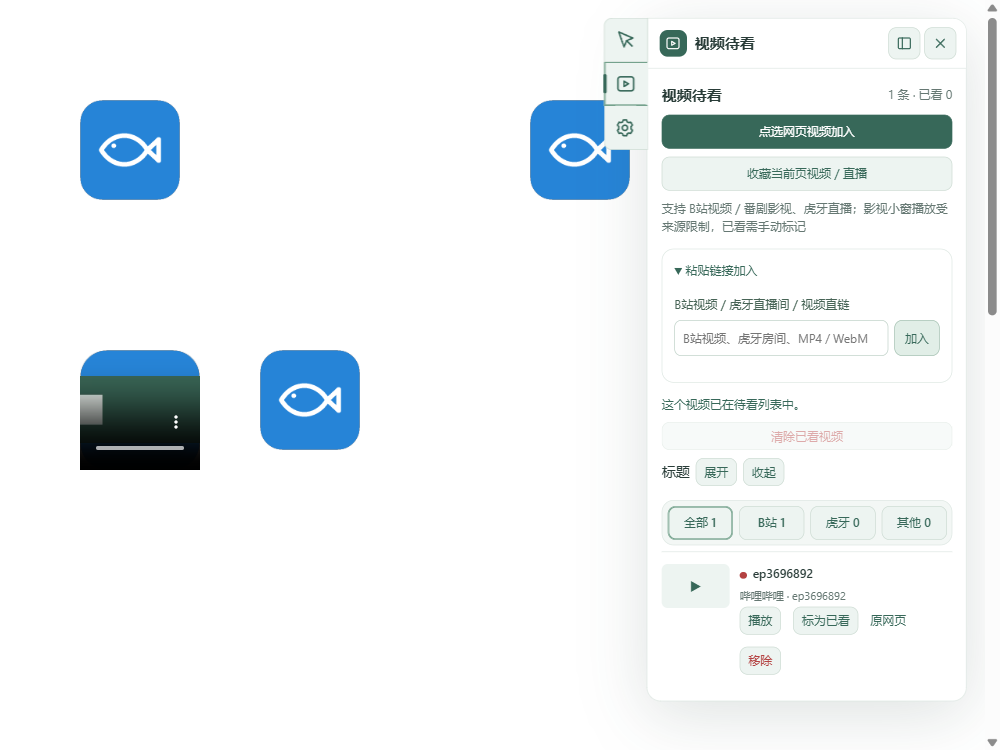
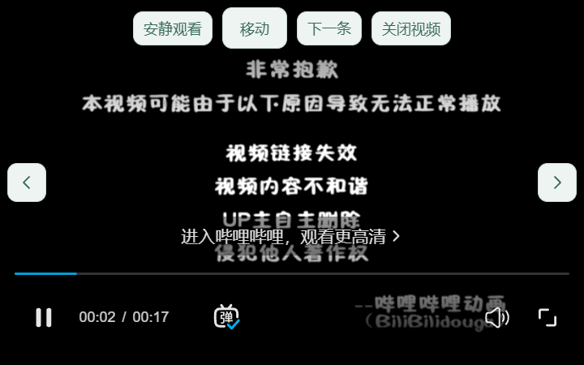

# 摸鱼助手 0.18.8：图片滚轮、视频封面避让和B站番剧收藏

交付日期：2026-11-13。[下载免安装版](摸鱼助手-免安装版-0.18.8.zip)。

## 本轮行为

1. 修复滚轮连续缩放后气泡换侧、鼠标落到下层网页的问题。缩放时不再按源图片锚点重算方向，沿用当前位置并校正视口边界；缩小时保持指针在圆角内侧。连续滚轮无需重新移入，仍保存尺寸并给下一张图沿用。放大到视口上限时保持在窗口内。
2. 悬停只预览普通图片。实际video/iframe不创建额外预览；可识别的视频、番剧、直播链接封面，标准VideoObject元数据和小范围播放器容器内封面会跳过。网页自身把封面替换成视频时，局部MutationObserver关闭原气泡，保留网页本来的播放行为。没有网站CSS类或专用DOM选择器。无任何媒体线索的静态图片不能保证识别为封面。
3. 原先仅接受BV/av普通视频，因此用户的 /bangumi/play/ss231258 被拒绝。现在增加ep剧集和ss季链接，仍在同一个B站队列。ss链接依据同源公开HTML中的标准canonical解析为具体ep；当前链接确认成ep3696892“驯龙高手 重回家园”。季与剧集去重为一项，点选链接、粘贴链接和收藏当前页沿用现有入口。季链接不是整个剧集目录导入，收藏的是该页面canonical指向的一集。

季解析不使用登录Cookie、不读取私有接口、不下载媒体、不执行响应脚本；只请求标准化后的www.bilibili.com公开页面，拒绝重定向、外域canonical和超限页面。现有网站授权不足或解析失败时提示打开具体ep页再收藏，不写未确认季身份。使用现有可选网站授权，没有新增权限；数据仍走现有串行资料库写入器，新旧备份保持schemaVersion 1。

播放入口继续沿用B站官方player.bilibili.com/player.html的episodeId参数，登录、会员、试看和地区限制由B站决定。原网页明确显示“大会员专享、试看中”。但实际桌面截图进一步确认：官方小窗返回的是约17秒的错误提示片，画面提示“视频链接失效／视频内容不规范／UP主自主删除”等，并非本电影。补充seasonId、kind参数或使用该影片公开BV号的官方嵌入测试也仍返回同样长度的错误媒体。

因此本影片的外链播放验证**未通过**：现在可加入列表、去重和备份，但需要点现有“原网页”入口观看。最初只凭解码和进度判断成功的结论已经撤回；错误提示片也会解码并前进，不能当作电影播放成功。番剧影视当前仅手动标记已看，错误片不能自动把电影标成已看，普通视频和直播仍沿用原来的实际播放进度标记。[B站官方嵌入参数文档](https://player.bilibili.com/)。

## 腾讯新链接为什么仍不能加入

https://v.qq.com/x/cover/mzc002000iis17y/r4102jp35bc.html 仍不能加入，是当前尚无正式腾讯播放适配，现有解析器拒绝该页面链接，与浏览器是否登录无关。已用D盘新建测试资料检查对应官方嵌入页，本次观察到广告媒体，未确认完整正片；不能把广告播放当作接入成功。上一条腾讯链接曾明确显示“可试看05:00”，不能推定新链接一定同样限制，也不能推定扫码后即可解除。

本版没有腾讯登录入口，没有读取、复制或保存用户的浏览器Cookie，也没有将腾讯列为正式支持平台。

## 按范围验证

38个相关检查点通过，另有两项现有成品包校验通过，未重复385项历史检查。检查通过不代表本电影播放通过；来源失败已单独记录。

| 范围 | 检查点 |
| --- | ---: |
| 连续滚轮不重新hover、圆角边缩小、尺寸记忆、封面避让/动态视频、真实B站季解析/粘贴/当前页收藏 | 12 |
| 番剧身份、官方嵌入重建、错误输入、旧备份兼容、同源canonical/容量/错误拒绝 | 7 |
| 原有虎牙、B站多P、临时流拒绝、已看及备份兼容回归 | 11 |
| 官方错误片辨认及防误标、现有原生窗口对返回媒体的隐藏/暂停/恢复、普通媒体自动已看回归及退出 | 8 |

原生验证用D盘独立助手和WebView2资料，无日常注册表登记。环境限制系统鼠标移动，原生隐藏测试使用现有测试管道注入检测计时器的鼠标坐标；确认了真实窗口隐藏及媒体暂停/恢复，不冒充真实系统鼠标自动操作。浏览器验证仅在独立资料中给测试副本站点授权；不代用户完成日常授权，没有读取原浏览器资料。仅构建兼容MSI，没有执行真实安装、升级或卸载。

源码对比除版本号外仅panel.js、video-common.js、video-background.js、video-page.js、用户说明，以及原生播放器的一处番剧自动已看保护发生改动。公共BUTTON_CSS、权限清单、原子资料库核心、配对和其余原生代码均未变；对比验证原生只增加番剧不自动标记已看的条件。主包65个白名单文件，不含测试资料或运行缓存。

ZIP SHA-256：`82a4b43bd4c064226f01db9b9c2f44d98e7bae26a46a6766aa363c6cc726fdab`。

## 更新

关闭浏览器、主面板和视频后更新程序与插件文件，保留“资料库、data、导出文件”。在原目录重新加载插件并刷新网页，不先卸载或清空数据。原插件已有授权继续沿用。

